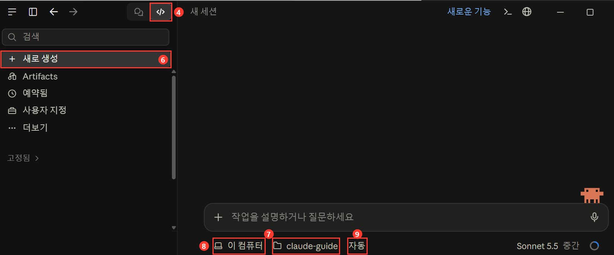

# 2장. 설치하고 첫 대화 하기

> [!info] 확인한 날짜
> 2026-10-15 · 공식 문서: <https://code.claude.com/docs/en/desktop>

> [!note] Windows 기준
> Mac은 같은 앱의 Mac용 설치 파일을 받으세요. 화면은 공식 문서를 보면 됩니다.

## 3줄 요약
> [!summary] 먼저 기억할 것
> - Claude 데스크톱 앱을 설치하고 로그인하면 Code 화면을 쓸 수 있습니다.
> - 작업 폴더를 고르고 말로 시키면 시작됩니다.
> - 처음에는 Manual(수동) 모드로 두세요. 하나씩 허락을 받고 진행합니다.

## 핵심 개념
- Claude 데스크톱 앱은 컴퓨터에 설치하는 Claude 프로그램입니다. 안에 Claude Code가 들어 있어서 따로 설치할 게 없습니다.
- Code 화면은 앱 왼쪽 위의 `</>` 아이콘을 누르면 열립니다. 여기서 폴더를 고르고 일을 시킵니다.
- 작업 폴더는 Claude가 일해도 되는 폴더입니다.

> [!tip] 연습용 폴더
> 연습용으로 새 폴더를 하나 만드세요.

> [!warning] 유료 구독
> 유료 구독이 필요합니다. 플랜은 공식 가격 페이지에서 확인하세요.

## 따라 하기

1. 위 공식 문서 링크에서 Windows용 설치 파일을 내려받습니다. 파일이 x64와 ARM64로 나뉘어 있으면 x64를 받습니다. ARM 칩이 든 PC에서만 ARM64를 받습니다.
2. 내려받은 파일을 실행해 설치합니다.
3. Claude를 열고 계정으로 로그인합니다.
4. 왼쪽 위의 `</>` 아이콘을 누릅니다. 옆의 말풍선 아이콘은 일반 채팅입니다.

4번을 누르면 아래와 같은 화면이 나옵니다. 그림의 빨간 번호는 이 목록의 단계 번호와 같습니다.



5. 바탕화면에 `claude-practice` 폴더를 새로 만듭니다.
6. 화면 왼쪽의 `+ 새로 생성`을 누릅니다. 위쪽에 "새 세션"이라고 나옵니다.

> [!note] 용어: 세션
> Claude와 나누는 대화 한 건입니다.

7. 입력창 아래의 폴더 이름을 눌러 `claude-practice`를 고릅니다.
8. 폴더 이름 왼쪽의 `이 컴퓨터`는 그대로 둡니다. 내 PC에서 실행한다는 뜻입니다.
9. 폴더 이름 오른쪽의 권한 모드(지금은 `자동`)를 눌러 `Manual`을 고릅니다. 하나씩 허락을 묻는 모드입니다.
10. 입력창에 아래 첫 대화 프롬프트(Claude에게 시키는 말) 중 하나를 넣고 Enter를 누릅니다.
11. 허락을 묻는 창이 뜨면 내용을 읽고 허용하거나 거절합니다.
12. 멈추고 싶으면 정지 버튼이나 Esc를 누릅니다.

### 첫 대화 프롬프트
연습 폴더에서 아래 세 가지를 순서대로 따라 해 보세요.

폴더 확인:
```
이 폴더에 무엇이 있는지 알려줘. 비어 있으면 비어 있다고 말해줘.
```

파일 만들기:
```
hello.md 파일을 만들어줘. 내용은 "안녕하세요, 첫 연습입니다"와 오늘 할 일 3개(가상)로 해줘.
```

결과 고치기:
```
방금 만든 hello.md의 할 일을 표로 바꿔줘. 완료 칸도 추가해줘.
```

### 개발자용 부록: 터미널(CLI)
터미널로 쓰는 방법도 있습니다. 비개발자는 건너뛰어도 됩니다. 설치 방법은 [공식 문서](https://code.claude.com/docs/en/overview)에 있습니다.

## 예제와 다음 장
- 다음: [3장. 안전하게 쓰기](03-안전하게-쓰기.md)
