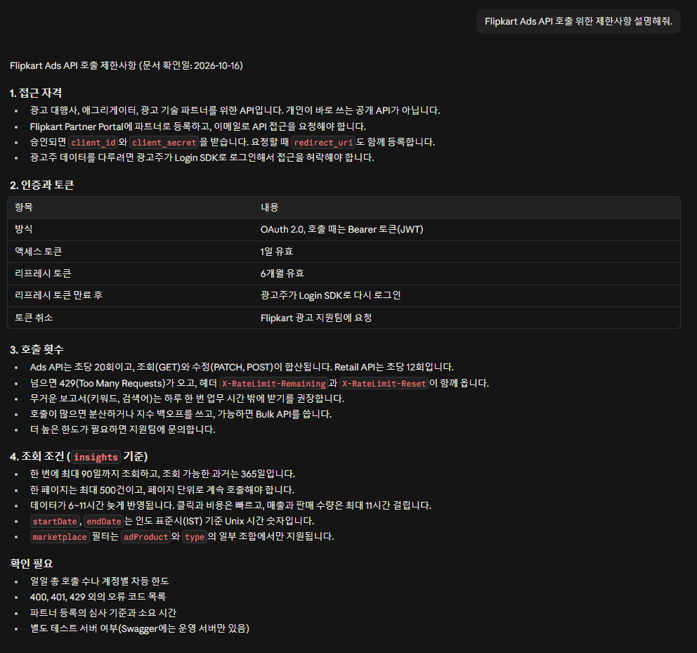

# 5장. 스킬 만들고 쓰기

> [!info] 확인한 날짜
> 2026-10-15 · 공식 문서: <https://code.claude.com/docs/en/skills>

## 3줄 요약
> [!summary] 먼저 기억할 것
> - 스킬은 반복되는 일의 작업 절차서입니다. 필요할 때 Claude가 꺼내 씁니다.
> - `SKILL.md` 파일 하나를 폴더에 넣으면 됩니다.
> - 지침은 항상 적용되는 규칙이고, 스킬은 특정 일의 순서입니다.

## 핵심 개념

### 지침과 스킬
| | 지침 (CLAUDE.md) | 스킬 (SKILL.md) |
|---|---|---|
| 역할 | 항상 지키는 규칙 | 특정 일을 하는 순서 |
| 읽히는 때 | 대화를 시작할 때마다 | 관련된 요청이 올 때 |
| 예 | "존댓말로 쓴다" | "API 문서는 인증, 주소, 응답 필드, 한도 순으로 정리한다" |

### SKILL.md의 구조
```
---
name: api-analysis
description: 언제 쓰는 스킬인지 한두 문장
---

# 제목
## 절차
## 출력 형식
## 규칙
```
- name은 스킬 이름입니다.
- description이 가장 중요합니다. Claude가 이 설명을 보고 스킬을 쓸지 정합니다.

> [!tip] description 쓰는 법
> 사용자가 실제로 할 말("API 분석해 줘")을 넣으세요.

## 따라 하기
1. 이 가이드 상위 폴더의 `.claude/skills/api-analysis` 폴더를 통째로 복사합니다. 폴더 안에 [SKILL.md](../.claude/skills/api-analysis/SKILL.md)가 있습니다.
2. 내 작업 폴더의 `.claude/skills/` 안에 붙여 넣습니다. 결과는 `.claude/skills/api-analysis/SKILL.md`가 됩니다.
3. 새 세션을 엽니다.
4. [Flipkart 예시](../.claude/skills/api-analysis/example-flipkart.md)를 엽니다.
5. `시킬 말` 아래의 글상자 내용을 복사해 입력창에 붙여 넣고 Enter를 누릅니다.
6. 결과에 인증, 주소, 응답 필드, 사용 한도 표가 나오는지 봅니다.
7. 이어서 "Flipkart Ads API 호출 위한 제한사항 설명해줘."라고 물어봅니다.

문서를 읽은 뒤라서, 아래 그림처럼 제한사항만 따로 정리해 줍니다.



8. 결과가 다르면 `SKILL.md`의 절차나 출력 형식을 한 줄씩 고칩니다.

> [!tip] 막혔을 때
> 주소를 읽지 못했다는 답이 오면 Flipkart 예시 파일의 `주소를 읽지 못했다고 하면` 부분을 따라 하세요. 직접 스킬을 만들 때는 `api-analysis`를 복사해 이름과 내용을 바꾸는 것이 가장 쉽습니다.

## 더 알아보기: 팀과 나누기
1. 공유 폴더에 `CLAUDE.md`와 `.claude/skills/`를 둡니다.
2. 팀원은 그 폴더를 작업 폴더로 열어 같은 규칙을 씁니다.
3. 고친 점은 한 사람이 정리해 반영합니다.

## 더 알아보기: 플러그인
스킬 여러 개를 묶어 설치하는 방식이 플러그인입니다.

> [!tip] 처음에는 필요 없습니다
> 팀에서 쓸 때 공식 문서를 참고하세요.

## 예제와 다음 장
- 참고: [API 분석 스킬](../.claude/skills/api-analysis/SKILL.md), [Flipkart 예시](../.claude/skills/api-analysis/example-flipkart.md)
- 실제 사례: 이 가이드 상위 폴더의 [check-chapter 스킬](../.claude/skills/check-chapter/SKILL.md)
- 처음으로: [README](README.md)
